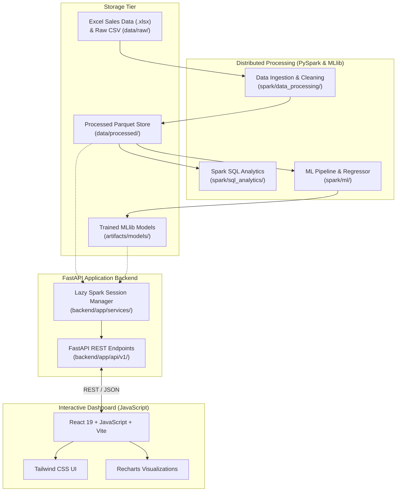

# CoffeePulse Architecture Specification

## 1. System Overview

**CoffeePulse** is a distributed coffee shop sales intelligence and daily revenue prediction system designed for a Cluster Computing course. The architecture balances real-world distributed data processing paradigms with the simplicity required for reliable local execution on a college development workstation.

## 2. Component Decoupling & Lazy Spark Architecture

A common pitfall in data engineering applications is spinning up a heavyweight Spark JVM session during every API import, test run, or health check. CoffeePulse employs a **Lazy Spark Session Manager** pattern:

- **FastAPI Startup**: FastAPI boots in milliseconds. Health checks (`/health`) probe file system paths and service availability immediately without invoking the JVM.
- **On-Demand Processing**: Spark is only initialized when batch ETL or ML training jobs are explicitly requested.
- **Graceful Shutdown**: The FastAPI lifespan context automatically halts any active SparkSession upon server termination.

## 3. Storage Hierarchy

- `data/raw/`: Original transactional Excel workbooks (`.xlsx`) and CSV logs from point-of-sale systems.
- `data/processed/`: Snappy-compressed, columnar Parquet files partitioned for distributed Spark SQL querying.
- `artifacts/models/`: Serialized MLlib PipelineModels ready for offline evaluation and revenue inference.
